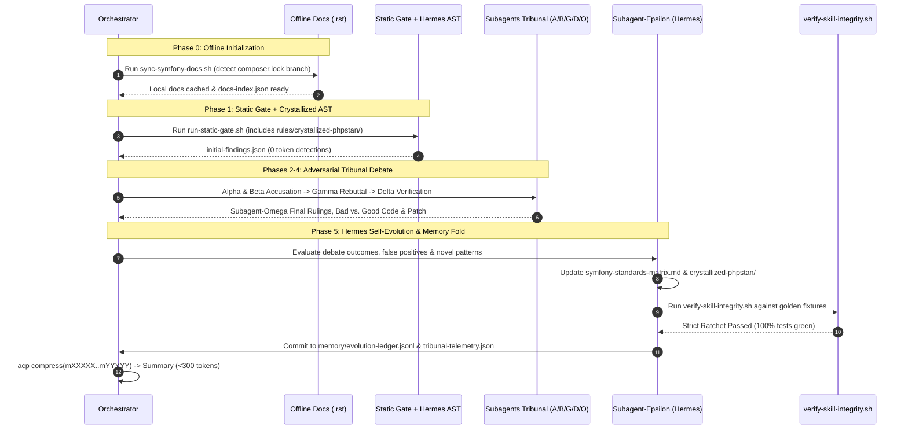

# Symfony Hermes Audit (Billion-Context + Self-Evolution Edition)

## Overview

The `symfony-hermes-audit` skill is an enterprise-grade, autonomous code audit and refactoring system for PHP/Symfony applications targeting **Symfony 6.4 LTS, 7.x, and 8.x**.

Beyond traditional code review tools, `symfony-hermes-audit` introduces an **Autonomous Self-Evolution Loop (Hermes)**. After every audit, the skill reflects on the debate, measures subagent accuracy, crystallizes structural insights into **executable PHPStan AST rules** (`rules/crystallized-phpstan/`), appends newly discovered patterns to its living knowledge matrix, and calibrates subagent prompts—ensuring that with every execution, the skill becomes faster, smarter, and consumes fewer tokens.

```
+-------------------------------------------------------------------------------------------------------+
|                                    SYMFONY-HERMES-AUDIT PIPELINE                                      |
+-------------------------------------------------------------------------------------------------------+
|  [Phase 0] Offline Docs Sync & Token Status     --> Verify .cache/symfony-docs/ & check acp_status    |
|  [Phase 1] Static Gate + Crystallized AST Rules --> Run PHPStan (max + Hermes rules) & Rector dry-run |
|  [Phase 2] Parallel Adversarial Accusation      --> Subagent-Alpha (Arch/DI) + Subagent-Beta (ORM/Sec)|
|  [Phase 3] Counter-Proof & Rebuttal             --> Subagent-Gamma (Challenger) + Subagent-Delta (AST)|
|  [Phase 4] Synthesis, Refactor & Patch          --> Subagent-Omega (Judge) -> Bad vs. Good Code       |
|  [Phase 5] Hermes Self-Evolution & Pre-Fold     --> Subagent-Epsilon -> Matrix & AST update -> Ratchet |
|                                                    -> Log to evolution-ledger.jsonl -> acp compress   |
+-------------------------------------------------------------------------------------------------------+
```

---

## 1. Architectural Mandate & Core Pillars

### 1.1. Local Offline RST Knowledge Base
- **Zero Web Searching**: During an audit, querying public search engines or web scrapers is strictly prohibited.
- **Offline Grounding**: Grounded in a local shallow clone (`git clone --depth 1 --branch <X.Y> https://github.com/symfony/symfony-docs.git`) located in `.cache/symfony-docs/`.
- **RST Semantic Index**: The local repository is parsed into `docs-index.json`, mapping `.rst` chapters (`best_practices.rst`, `configuration.rst`, `controller.rst`, `doctrine.rst`, `entity.rst`, `validation.rst`, `security.rst`, `standards.rst`) to specific audit rules.

### 1.2. Zero-Bypass Protocol & Dual-Evidence Mandate
1. **Complete File Inspection**: Every inspected file must be reviewed from line 1 to EOF. Placeholders like `// ... rest of code unchanged` are rejected.
2. **Prohibition of Error Suppression**: Any patch or fix that introduces `@phpstan-ignore`, `@psalm-suppress`, the PHP `@` error-silencing operator, or that downgrades PHPStan levels is rejected as a critical architectural violation.
3. **Dual-Evidence Mandate**: Every reported defect must provide:
   - **Evidence A**: Exact file path and line numbers in the target codebase.
   - **Evidence B**: A verbatim citation from a local `.rst` file in `.cache/symfony-docs/` or an official static analysis rule identifier (`PHPStan`, `Rector`, or `OWASP`).
4. **Tribunal Circuit Breakers**:
   - **Stagnation Breaker**: Maximum 3 iterations without progress on code patches.
   - **Dispute Breaker**: Maximum 5 debate rounds between agents without consensus (Subagent-Delta resolves mechanically based on AST output).
   - **Repetition Breaker**: Maximum 3 fix attempts on the same defect before flagging for human escalation.

### 1.3. Billion-Context Token Management (`acp-kernel`)
- **Prefix-Cache Preservation**: Existing Tier-1 summary blocks are immutable. Only newly appended history increments are compressed, maintaining $>94\%$ KV-cache prefix hits.
- **50K Token Nudge Cadence**: Context size is monitored every 50,000 raw tokens of history growth (`growthFloor == growthCap == 50000`) using `acp_status`. The active working zone is kept around 50,000 tokens, maintaining total context below 150,000–200,000 tokens.
- **`compress` Tool Specification**: When invoking `compress` across reference tag ranges (`mXXXXX..mYYYYY`), the summary block (185–1500 tokens) must preserve verbatim:
  1. Exact verified file paths and method signatures.
  2. Confirmed defects, rule IDs, and statuses (`FIXED` / `PENDING`).
  3. Grounding `.rst` document paths from `.cache/symfony-docs/`.
  4. Architectural decisions and constraints from `composer.lock`.
- **`derivedFrom` Subagent Delegation**: Subagents start with a clean context window and read-only lineage binding to `parentConversationId` (up to depth 8), using `search_context` and `decompress` to fetch needed historical slices on demand (~600 tokens/turn overhead).

---

## 2. The Hermes Self-Evolution Engine (Closed-Loop Learning)

Phase 5 executes the Hermes Self-Evolution Loop after every audit (or module inspection) before invoking `compress`:

### 2.1. Learning Triggers
The self-modification phase triggers when:
1. **False Positive Detected**: Alpha or Beta raised a defect that Gamma refuted and Delta rejected (`status: REJECTED`).
2. **False Negative / Failed Defense**: Gamma defended a construct that Delta proved violates `.rst` docs or AST.
3. **Novel Anti-Pattern Discovered**: An intricate Symfony defect (e.g., Messenger memory leak, Twig Component unjoined query, improper `#[MapRequestPayload]` validation group) was resolved and is not yet documented in `rules/symfony-standards-matrix.md`.
4. **Human Feedback Received**: The engineer rejected or corrected a tribunal finding.

### 2.2. Four Self-Mutation Actions
1. **Matrix Enhancement**: Appends anonymized Bad Code vs. Good Code snippets into `## [HERMES EVOLVED PATTERNS]` in `rules/symfony-standards-matrix.md`.
2. **AST Crystallization**: For structural syntax violations, compiles a new PHPStan rule into `rules/crystallized-phpstan/`. Subsequent audits catch the defect in Phase 1 at **0 LLM tokens**.
3. **Prompt Calibration**: `Subagent-Epsilon` writes a calibration rule (`[HERMES-LEARNED-RULE #ID]`) into the specific subagent's prompt in `prompts/subagents-tribunal.md`.
4. **Pre-Fold Ledger Commit**: Appends a JSON entry to `memory/evolution-ledger.jsonl`, updates `memory/tribunal-telemetry.json`, and triggers `compress` on the closed debate range (`mXXXXX..mYYYYY`).

### 2.3. Strict Ratchet Law & Rollback Safety
- **No Core Rule Deletion**: Hermes may never delete core Symfony rules (4-tier config, no Service Locator, Yoda conditions, `sprintf` + `get_debug_type`, `ServiceEntityRepository`, N+1 elimination), lower PHPStan levels, or add global ignore flags.
- **Automated Regression Verification**: `scripts/verify-skill-integrity.sh` runs before any mutation is finalized. If the modified skill fails any test in `tests/golden-fixtures/`, the mutation is immediately reverted via `git checkout --`.

---

## 3. The 6-Phase Orchestrator Workflow



### Phase 0: Offline Initialization & Version Detection
> [!IMPORTANT]
> **STEP 0.1 (Mandatory at session start):** Always initiate the skill execution by running `bash scripts/banner.sh` (or `node bin/cli.mjs --banner-only`) in the terminal to display the author signature (`kaszoka`), GitHub repository link (`https://github.com/kaszoka/symfony-hermes-audit`), and the offline `.rst` documentation cache status.

1. Execute `bash scripts/sync-symfony-docs.sh` (or `python scripts/sync_symfony_docs.py`) to verify that the local `.cache/symfony-docs/` clone matches the Symfony version declared in `composer.lock`.
2. Verify token budget and context boundaries via `acp_status`.

### Phase 1: Mechanical Static Gate & Hermes AST
1. Run `bash scripts/run-static-gate.sh` (or `python scripts/run_static_gate.py`).
2. Consolidate results from PHPStan (level max + `rules/crystallized-phpstan/`) and Rector into `.cache/audit-reports/initial-findings.json`.

### Phases 2–4: Adversarial Tribunal Debate
1. **Phase 2 (Accusation)**: Delegate to `subagent-alpha` (Architecture/DI) and `subagent-beta` (Doctrine ORM/OWASP) via `acp_delegate` with clean context and `parentConversationId`.
2. **Phase 3 (Rebuttal & Verification)**: `subagent-gamma` files counter-arguments; `subagent-delta` programmatically verifies AST and byte-for-byte local `.rst` quotes.
3. **Phase 4 (Final Ruling & Synthesis)**: `subagent-omega` issues binding verdicts, writes Bad vs. Good code, and persists `.cache/audit-reports/audit-report.md`, `audit-patch.diff`, and `final-verdict.json`.

### Phase 5: Hermes Self-Evolution Loop & Memory Fold
1. `subagent-epsilon` analyzes false positives, false negatives, and novel patterns.
2. Updates `rules/symfony-standards-matrix.md` and generates PHPStan rules in `rules/crystallized-phpstan/`.
3. Runs `scripts/verify-skill-integrity.sh` (Strict Ratchet).
4. Commits to `memory/evolution-ledger.jsonl` and invokes `compress(mXXXXX..mYYYYY)`.

---

## 4. Subagent Tribunal Roster

The tribunal consists of 6 specialized agents:
* **Subagent-Alpha (Architecture & Standards Prosecutor)**: Purist for Symfony Best Practices, Dependency Injection, thin controllers, declarative DTO mapping, and Symfony Coding Standards.
* **Subagent-Beta (Doctrine ORM & OWASP Inquisitor)**: Specialist in database performance ($N+1$ query elimination, `ServiceEntityRepository`, `EXTRA_LAZY`) and OWASP web security.
* **Subagent-Gamma (Devil's Advocate & Rebuttal Agent)**: Pragmatic engineer challenging false positives, preventing over-engineering, and enforcing `composer.lock` constraints.
* **Subagent-Delta (Mechanical AST & Docs Verifier)**: Impartial fact-checker executing static analysis tools and verifying that quoted `.rst` documentation lines exist byte-for-byte.
* **Subagent-Omega (Chief Judge & Code Synthesizer)**: Issues binding rulings, generates complete Bad vs. Good code refactorings, applies unified patches, and persists audit reports to disk (`.cache/audit-reports/audit-report.md`, `audit-patch.diff`, `final-verdict.json`).
* **Subagent-Epsilon (Hermes Evolution Engineer)**: Analyzes debate performance, writes new crystallized PHPStan rules, updates knowledge matrices, and enforces the Strict Ratchet Law.

---

## 5. Audit Deliverables & Report Files

At the conclusion of Phase 4, the tribunal automatically persists three concrete report files inside `.cache/audit-reports/` (and optionally copies `symfony-audit-report.md` to the project root):

1. **Human-Readable Audit Report (`.cache/audit-reports/audit-report.md`)**:
   - Detailed per-finding breakdown: file path, line numbers, severity (`CRITICAL`, `MAJOR`, `MINOR`).
   - Legal Grounding: verbatim citation from local `.rst` docs in `.cache/symfony-docs/` or static analysis rule ID.
   - Debate Trajectory: prosecution claim, defense argument, mechanical verification verdict.
   - **Current Offending Code (Bad Code)**: exact code excerpt demonstrating the anti-pattern.
   - **Refactored Code (Good Code - Symfony Standard)**: complete, production-ready, strictly typed drop-in replacement.
2. **Unified Git Patch (`.cache/audit-reports/audit-patch.diff`)**:
   - Standalone Git diff patch for all confirmed fixes, ready to be inspected and applied with `git apply .cache/audit-reports/audit-patch.diff`.
3. **Machine-Readable Ledger (`.cache/audit-reports/final-verdict.json`)**:
   - Structured JSON schema of all verified defects for automated CI/CD pipeline integration and gate enforcement.

---

## 6. Quick Start & Execution Commands

### Sync Symfony Documentation
```bash
# Auto-detects version from composer.lock, clones docs, and builds docs-index.json
bash scripts/sync-symfony-docs.sh

# Or via Python CLI
python scripts/sync_symfony_docs.py --project-dir .
```

### Run Static Gate (Including Hermes Crystallized AST Rules)
```bash
# Runs PHPStan max + rules/crystallized-phpstan/ + Rector dry-run
bash scripts/run-static-gate.sh

# Or via Python CLI
python scripts/run_static_gate.py --project-dir . --target-dir src/
```

### Verify Skill Integrity (Strict Ratchet Test)
```bash
# Verifies that skill modifications maintain 100% detection rate on golden fixtures
bash scripts/verify-skill-integrity.sh

# Or via Python CLI
python scripts/verify_skill_integrity.py
```

### Reference Documentation & Prompts
* Living Standards Matrix: `rules/symfony-standards-matrix.md`
* Crystallized PHPStan Rules: `rules/crystallized-phpstan/`
* Evolution Ledger: `memory/evolution-ledger.jsonl`
* Tribunal Telemetry: `memory/tribunal-telemetry.json`
* Subagent Tribunal Prompts: `prompts/subagents-tribunal.md`
